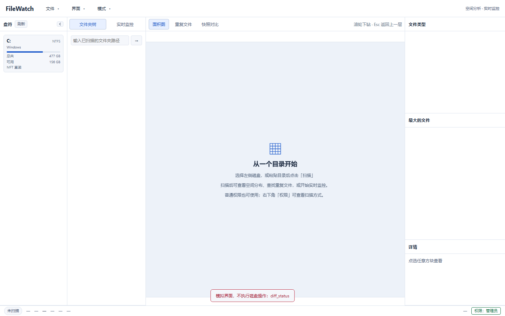
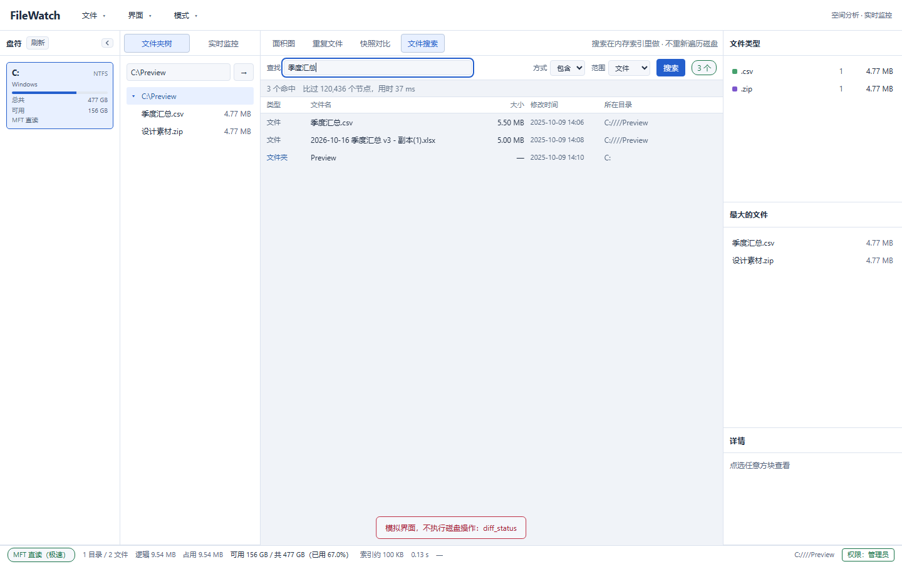

# FileWatch —— 文件增量监控工具（Windows / Linux）

用 NTFS `$MFT` 直读 + USN Journal（Windows）或目录遍历 + `inotify`（Linux）
做全盘扫描与实时监控，配 Squarified Treemap 面积图看清楚"空间到底被谁吃了"。

**不装驱动、不常驻索引服务、不联网。** 扫一次把目录树（名字 / 大小 / 时间）
装进内存，之后靠增量事件更新；200 万文件的盘通常几秒扫完（Windows MFT 路径），
常驻内存控制在几百 MB 以内。



## 能做什么

| 能力 | 说明 |
|---|---|
| 全盘扫描 | `$MFT` 直读（需管理员）或目录遍历（普通权限）。两条路功能一致，只是快慢差 1~2 个数量级，界面会明确标注用的是哪条 |
| 面积图 | Treemap 下钻，按文件类型 / 目录深度 / 修改时间着色；滚轮缩放、Esc 返回 |
| 扫描期预览 | 扫到多少画多少：扫描中途就把根的第一层画出来（半成品视图，200 ms 刷新一次），扫完自动切成完整面积图。降级模式（目录遍历）同样有效 |
| 实时监控 | USN 增量，事件不丢不重；变更流水可导出 CSV |
| 阈值预警 | `abs=` / `grow=` / `rate=` 三种规则（与 CLI 同一套语法），带滞回与冷却；命中时**系统通知 + 托盘图标闪动 + 托盘菜单记一条**，窗口收起来也看得见 |
| 重复文件 | 体积 → 首尾哈希 → 全哈希 → **逐字节复核**；只查找、不删除 |
| 快照对比 | 存一份 `.tsv` 快照，过一段时间再比：谁新增 / 删除 / 变大 / 变小，六列表格 + CSV |
| 增长归因 | 对比结果顺手回答"这一周 50 GB 长在**哪儿**"：目录（前 3 层）/ 类型 / 时段三个榜，与文件级明细互补 |
| 详情面板 | 点任意节点看 FRN（引用号）、硬链接数、创建时间、稀疏 / 压缩 / 加密等属性。一半来自扫描时的 MFT，一半来自点击时的系统查询，界面上分开放、不混着说 |
| 规则试算 | 写阈值规则之前先试算：对当前索引跑一遍，立刻知道会不会一上来就刷屏、离阈值还差多少（增量 / 速率规则要跑起来才有意义，界面会直说） |
| 风险清单 | 按文件名与扩展名盘点私钥 / 密码库 / 云凭据 / 证件类文件。只看名字、**不读内容**，命中分级，只列不删 |
| 离线报告 | 导出**单个 HTML**（概览 + 目录面积图 + 三张榜），无脚本无外链，断网能开、可直接转发 |
| 文件搜索 | 在**内存索引**里搜名字（包含 / 模糊 / 正则），也可搜纯文本文件的内容（txt / 日志 / CSV / 源码） |
| 增长趋势 | 每天留一个**目录级**小样本（不是文件清单，一个月不到 1 MB），画总量曲线；并用前 7 天的日增量算基线，报「今天哪个目录长得不正常」。基线不足 3 天时只显示还差几天，**不给 z 值** |
| 常驻托盘 | 可设为「关闭窗口只收进托盘」，监控继续跑；可选开机自启 |



## 不做什么

* **不删文件**。重复文件只列出来，删不删由你自己决定。
* **不上传任何数据**。没有遥测、没有联网检查更新。
* **不改磁盘内容**。读 `$MFT` 与 USN 都是只读；监控只读元数据，不锁定文件。
* **不解析 Office 文档内容**（docx/xlsx/pptx 是压缩包，引擎层刻意零第三方依赖）。

---

## Linux 支持（引擎 + CLI）

同一份源码，两个平台各用自己最好的那条路。**引擎层仍然零第三方依赖**：
Linux 的 `inotify` / `statvfs` / `signal` 也是手写 `extern "C"` 声明，
不引 `libc` / `inotify` / `nix` 任何 crate。

| 能力 | Windows | Linux |
|---|---|---|
| 卷/挂载点枚举 | `GetLogicalDriveStringsW` | `/proc/self/mounts` + `statvfs` |
| 全量扫描 | `$MFT` 直读（管理员）／目录遍历 | 目录遍历（`read_dir` + `lstat`） |
| 实时增量 | USN Journal ／ `ReadDirectoryChangesW` | `inotify` |
| 占用空间 | 按簇对齐估算 | `st_blocks × 512`（**真实**分配，稀疏文件会小于逻辑大小） |
| 路径分隔符 | `\` | `/`（`std::path::MAIN_SEPARATOR`，全项目只此一处口径） |
| 硬链接去重 | 仅 MFT 直读路径 | `st_nlink` 可用（体积去重仍按 `(dev, inode)` 之外的规则保守处理） |
| 快照 / 对比 / 重复文件 / 面积图 / 阈值预警 | ✅ | ✅ 完全相同 |
| GUI（Tauri） | ✅ | ⏳ 未移植（见下） |

### 构建与验收

```bash
# ① 在 Windows 上就能做的：Linux 目标的类型检查（不链接，挡住 90% 移植错误）
bash tools/linux_check.sh

# ② 在 Linux / WSL2 里做的：构建 + 单测 + 自检 + 端到端冒烟
bash tools/linux_smoke.sh
```

`linux_smoke.sh` 会自己造夹具树，逐项断言：卷枚举、扫描的文件数/体积/后端、
快照对比的四类变更、`inotify` 实机投递（含"新建子目录里的文件"这条最容易漏的
路径）、重复文件分组。

### WSL2 上测试的三个注意点

1. **不要在 `/mnt/c` 上测实时监控。** 那是 Windows 盘经 9p 挂进来的，
   Windows 侧程序做的改动**不会**产生 inotify 事件（Linux 侧自己写的才有）。
   测事件请用主目录（`~/...`，ext4）。扫描 `/mnt/c` 没问题，只是慢。
2. **`inotify` 的 watch 有上限**（`cat /proc/sys/fs/inotify/max_user_watches`，
   默认 8192~65536）。大盘递归监控会挂不满，此时工具**不静默**：
   `DirWatcher::failed_dirs()` 会计数，会话告警里写明"有 N 个目录没被监控"。
   临时调大：`sudo sysctl fs.inotify.max_user_watches=524288`。
3. `$MFT` / USN Journal 在 Linux 上没有对应物（`ntfs3` / `ntfs-3g` 都不暴露），
   所以 `probe` 只对**磁盘镜像文件**有意义，`journal` 命令会直接说明不可用，
   `top`（恒定内存扫描）也是 Windows 专属 —— 等价功能用 `scan <目录> --top=N`。
   `scan` 会自动走目录遍历，不需要 `--force-traverse`。
4. **路径用法不同**：Linux 直接给绝对路径（`filewatch scan /home/me/projects`），
   不需要也不接受 `C:` 这种盘符；"整个卷"就是挂载点本身（`filewatch scan /home`）。
5. 非 UTF-8 文件名在 Linux 上按 U+FFFD 显示（与 Windows 的 lossy 口径一致）——
   引擎的名字存储是 UTF-8 字符串池，这是数据模型的既定边界。

### 源码里平台分派在哪

```text
crates/core-io/src/
  consts.rs            两平台共用的数字（属性位 / 动作码 / FSCTL / 错误码）
  paths.rs             分隔符与「卷根前缀」的唯一口径
  fsmeta.rs            Metadata → (属性位, 修改时间, 占用, 链接数)
  volume.rs    ──┬─ volume/win.rs    \\.\C: + DeviceIoControl
                 └─ volume/linux.rs  /dev/xxx 或镜像文件 + pread
  volumes.rs           卷枚举（Windows / Linux 双实现，共享 VolumeInfo）
  winapi.rs    ──┬─ winapi.rs（Windows，真 FFI）
                 └─ winapi/linux.rs（只有类型与常量，一个函数都没有）

crates/core-scan/src/
  dirwatch.rs  ──┬─ dirwatch/win.rs    ReadDirectoryChangesW（OVERLAPPED 异步）
                 └─ dirwatch/linux.rs  inotify（poll + 唤醒管道 + 递归补 watch）
```

`VolumeInfo` / `FsEvent` / `Tree` / 事件翻译层（`watcher.rs`）是**共用**的：
Linux 走的就是原来那条"降级路径"，只是把 `ReadDirectoryChangesW` 换成
`inotify` —— 这也是为什么两个平台的功能列表能一条条对上。

### 为什么 GUI 还没移植

GUI 是 Tauri 2，Linux 上要 `libwebkit2gtk-4.1-dev` / `libgtk-3-dev` 一整套系统库，
而且现有代码里权限提升（`ShellExecuteW(runas)`）、托盘图标、原生右键菜单
（`SHOpenWithDialog` / `SHOpenFolderAndSelectItems`）全是 Win32 实现。
这些不是"加个 `#[cfg]`"能解决的，需要各自写一份 Linux 实现（polkit / GIO /
`xdg-desktop-portal`）。所以本轮先把**引擎 + CLI 两个平台跑通、跑绿**，
GUI 留作下一步。

---


## 0. 只想打开软件看看

```powershell
python tools/package.py
.\dist\FileWatch-*-win64-*\FileWatch.exe          # 双击也行（目录名带时间戳）
```

包里是**绿色便携**的：`FileWatch.exe`（界面）、`WebView2Loader.dll`（必须在
exe 旁边，缺了启动即报错）、`cli\filewatch.exe`（命令行版）、`使用说明.txt`。
首次启动会问一次要不要管理员权限 —— 选哪个功能都全，只是快慢差 1~2 个数量级。

### 键盘快捷键

| 键 | 做什么 | 为什么值得记 |
|---|---|---|
| `Ctrl+F` | 进「文件搜索」页，光标落在输入框 | 在任何一个页签里都能用，不用先点页签 |
| `F5` | 重扫当前根（同「文件 → 重新扫描」） | 默认的 F5 在 WebView 里是**刷新页面**，会把整棵索引丢掉 —— 这里已经挡掉了 |
| `Esc` | 收起打开的一层（先菜单，再弹窗） | 一次只收一层，连按才逐层退 |
| `Shift+F10` / `菜单键` | 在选中的行上开右键菜单 | 纯键盘操作时用 |

---

## 1. 快速开始

```powershell
# 一键装工具链 + 构建 + 自检（引擎 + CLI）
powershell -ExecutionPolicy Bypass -File .\setup-rust.ps1

# 检查引擎是否完好（不需要管理员权限）
.\target\x86_64-pc-windows-gnu\release\filewatch.exe selftest --verbose
```

GUI 单独构建（它是自己的 workspace，见 `apps/gui/README.md`）：

```bash
python apps/gui/tools/make-icon.py        # 生成图标，只需一次
cd apps/gui/src-tauri && cargo build --release
./target/x86_64-pc-windows-gnu/release/filewatch-gui.exe   # 注意是三元组子目录
```

> **为什么要用 GNU 工具链**：开发机没有 Windows SDK 10（缺 `kernel32.lib`），
> Rust 默认的 MSVC 工具链会链接失败。`x86_64-pc-windows-gnu` 由 rustup 自带
> MinGW-w64（含 gcc 与导入库），**不需要任何 Visual Studio 组件**。
> `setup-rust.ps1` 会自动装好并把目标三元组固定进 `.cargo/config.toml`。
> 实测 Tauri 2 在同一套 GNU 工具链下也能正常编译、链接、启动（见
> `apps/gui/README.md` 的「两个必须知道的坑」）。

---

## 2. 能力与降级

程序**永远能跑**，但会用两条性能差 1~2 个数量级的路径。选哪条由环境决定，
且**一定会在输出里说清楚**，不做静默降级。

| | 快速路径 | 降级路径 |
|---|---|---|
| 全量扫描 | `$MFT` 直读，16 MB 顺序块 | 目录递归遍历 |
| 增量来源 | USN Journal（内核 32 MB 滚动日志，可断点续读） | `ReadDirectoryChangesW`（纯内存队列，进程不在即丢） |
| 节点标识 | FRN → 数组下标，O(1) 定位 | 自增序号 + 「小写绝对路径 → 下标」索引 |
| 权限要求 | **管理员** | 无 |
| 断线补偿 | 有（游标 + 重放） | 无 |
| 适用 | NTFS + 已提权 | 任何卷 / 任何用户 |

自检里的 `降级模式端到端：扫描→事件→增量` 一项，就是**在无管理员权限下**
跑通整条链路的自动化验收。

```powershell
filewatch volumes                 # 看当前能走哪条路
filewatch scan  C:                # 自动选；没权限就降级并说明原因
filewatch scan  C: --force-traverse   # 强制走降级路径（用于验证）
filewatch probe C:                # 需要管理员；失败会打印出该怎么办
```

### 管理员权限怎么拿（桌面端）

CLI 里由你决定在什么终端里跑；**桌面端是进入软件时问一次**（文档 R2）：

* 清单保持 `asInvoker` —— 不嵌 `requireAdministrator`。那样虽然"一劳永逸"，
  但每次双击都要过 UAC（包括只想看一眼面积图的时候），而且提权进程与资源管理器
  不在同一个完整性级别，拖放会静默失效。
* 没权限就弹窗说明两条路的差别，点「以管理员身份重启」后走 `runas` 重启自己；
  点「以降级模式继续」照常进界面，状态栏的橙色「权限」按钮随时能重新申请。
* 判定是**令牌 ∨ `\\.\C:` 能否打开**，不是只看令牌 —— 系统关掉 UAC 时令牌报
  "未提权"，但卷其实读得到，只看令牌会每次启动都追问一遍。
* 重启会给新进程塞 `--elevation-attempted`：见到它就不再自动弹窗，
  防止在"提权无效"的机器上「弹窗 → 重启 → 又弹窗」转圈。

想自查当前是什么状态（不开窗口、直接打 stdout）：

```powershell
.\apps\gui\src-tauri\target\x86_64-pc-windows-gnu\release\filewatch-gui.exe --check-elevation
```

---

## 3. 命令参考

```
filewatch <命令> [参数...]

volumes                     列出所有卷、文件系统与可用后端
probe <盘符>                读引导扇区 + $MFT 记录 0，逐字段对照 fsutil（M0 验收）
journal <盘符> [--status|--create|--delete]
scan <盘符> [选项]          全量扫描并输出统计（M1 验收）
top <盘符> [--n=20]         恒定内存找最大的 N 个文件（不建树）
monitor <路径> [选项]       实时监控 + 阈值预警（M2/M3 验收）
dupes <盘符|目录> [选项]    重复文件查找：体积 → 部分哈希 → 全哈希 → 逐字节复核（F12）
snapshot <盘符|目录> [选项] 把当前文件清单存成 .tsv 快照（F11）
diff <旧快照> <新快照>      对比两份快照，看谁新增/删除/变大/变小（F11）
selftest [--verbose]        免管理员的全链路自检
help / version
```

**位置参数怎么解释（Windows）**：只有 `c` / `C:` / `C:\` 三种写法算「盘符」→ 扫整卷
（才可能走 `$MFT`）；其它一律当目录，按当前目录解析成绝对路径，而且**必须存在**：

```powershell
filewatch search crates --text=main      # 只扫 crates 这一个目录
filewatch report . --out=r.html          # 只扫当前目录
filewatch search foobar --text=x         # 报错退出（码 2）
```

写错名字时**不会**悄悄退化成"扫整卷" —— 那个默认值最坏：又慢又不是你要的，
而且看起来还像成功了（这条是实测踩出来的：`search crates` 曾经扫了 150 万条）。

### scan

```powershell
filewatch scan C: --top=15 --exts=12
filewatch scan D: --root=D:\projects --json          # --root 自动切换为遍历模式
filewatch scan C: --layout=110x32 --top=0 --exts=0   # 字符网格预览面积图
filewatch scan C: --dedup                            # 解释与资源管理器的口径差异
```

| 选项 | 含义 |
|---|---|
| `--top=N` | 前 N 大文件（默认 20，0 = 不输出） |
| `--exts=N` | 扩展名 Top N（默认 15） |
| `--layout=WxH` | 字符网格预览 Squarified 面积图 |
| `--root=PATH` | 指定扫描根（$MFT 是整卷粒度，因此**自动切换为遍历模式**） |
| `--json` | 机器可读摘要 |
| `--chunk=BYTES` | 顺序读块大小（默认 16M） |
| `--max-depth=N` | 遍历模式最大深度（默认 256） |
| `--no-prealloc` | 关掉节点数组预分配（内存峰值更低、更慢） |
| `--force-traverse` | 强制降级 |

### monitor

```powershell
filewatch monitor $env:USERPROFILE\Downloads --rule=abs=1G --duration=60s
filewatch monitor D:\build --rule=grow=500M --rule=rate=5M/1m --changelog=out.jsonl
filewatch monitor C: --rule=abs=2G --create-journal      # 自动启用 USN Journal
```

规则语法（可重复给出多条）：

| 形式 | 含义 |
|---|---|
| `--rule=abs=1G` | **绝对阈值**：目录体积超过 1 GiB 报警 |
| `--rule=grow=500M` | **增长量**：相对基线增长超过 500 MiB 报警 |
| `--rule=rate=10M/60s` | **速率**：折算到 10 MiB/60 s 的速率报警 |

支持的单位：`B / K / KB / M / MB / G / GB / T / TB`（1024 进制）；
时间：`ms / s / m / h`。

| 选项 | 含义 |
|---|---|
| `--duration=60s` | 运行时长；缺省 = 一直运行到 Ctrl+C |
| `--interval=500ms` | 轮询间隔 |
| `--changelog=PATH` | 变更流水落盘（JSONL，64 MB 轮转） |
| `--create-journal` | 允许自动创建 USN Journal（**系统级变更**） |
| `--force-traverse` | 不碰裸设备句柄，强制走目录监视 |
| `--no-watch` | 连目录监视也关掉，只做一次性扫描 |
| `--no-subtree` | 只监视根目录直接子项 |
| `--watch-buffer=64K` | 目录监视缓冲（突发变更多时调大，防丢事件） |
| `--watch-max-nodes=N` | 实时增量的路径索引上限（默认 300000） |

### dupes（F12 重复文件）

```powershell
filewatch dupes D:\photos --min-size=1M --top=50
filewatch dupes C: --min-size=1M --csv=dups.csv --json      # 需要管理员才能走 MFT 直读
```

| 选项 | 含义 |
|---|---|
| `--min-size=1M` | 小于它的文件不参与比较（默认不限；0 字节文件永远排除） |
| `--top=N` | 最多输出多少组（按可回收空间降序，默认 200） |
| `--max-per-group=N` | 每组最多列出几个文件（真实数量仍如实计，默认 50） |
| `--block=4K` | 部分哈希读首尾各多少字节（默认 4 KiB） |
| `--max-candidates=N` | 候选数上限，防止 `--min-size=0` 把内存吃满（0 = 不限） |
| `--csv=FILE` / `--json` | 结果落盘 / 机器可读 |

**为什么快**：三级漏斗把绝大多数文件直接跳过。体积唯一的文件**一个字节都不读**；
体积相同的才读首尾各 4 KiB；还撞上的才读整份；最后再逐字节复核给出确定结论。
实测 6 个文件的小树只读了 617 KB —— 其中那份 200 KB 的"同体积不同内容"文件
在第二轮就被筛掉了。

**哈希为什么可以用非加密的 FNV-1a**：哈希只当**筛子**，最终判据是逐字节比对。
所以撞车不会导致误报（自检第 25 项专门用"强制所有哈希相等"的数据源把这条钉住），
也就不需要 SHA-256 那种开销。

### snapshot / diff（F11 快照对比）

```powershell
filewatch snapshot D:\projects --out=before.tsv
# …过一段时间，磁盘有变化…
filewatch snapshot D:\projects --out=after.tsv
filewatch diff before.tsv after.tsv --top=50 --min-delta=1K
filewatch diff before.tsv after.tsv --by-abs --csv=changes.csv
```

| 选项（snapshot） | 含义 |
|---|---|
| `--out=FILE` | 输出路径（默认 `snapshot-<本地时间戳>.tsv`） |
| `--max-entries=N` | 最多记多少个文件（0 = 不限；截断会如实标注） |

| 选项（diff） | 含义 |
|---|---|
| `--top=N` | 最多列出多少行（默认 50） |
| `--min-delta=1K` | 变化小于它的不进列表（仍计入统计） |
| `--by-abs` | 按变化幅度排序（变大变小混在一起） |
| `--by-path` | 按路径排序（便于与外部 `diff` 工具对照） |
| `--csv=FILE` | 明细落盘 |

快照是 **TSV 纯文本**（可读、可 `sort`/`grep`、体积接近二进制），第一行是魔数 +
版本号，`#count` 与实际条数不符即报错 —— 因为**截断的快照会让后半段全被判成
"已删除"**，用户可能照着它去清理并不存在的垃圾。写入先落 `.part` 再改名，
中途被杀不会留下一份"看起来正常、少了一半"的文件当基准。

加 `--attrib` 会多打三个榜（目录 / 类型 / 时段）。归因必须在 diff 里顺带算：
它要的是**全量**变化行，而 `--top` 之后明细只剩前几十行。

```powershell
filewatch diff before.tsv after.tsv --attrib
```

### report（离线 HTML 报告）

```powershell
filewatch report D:\projects --out=report.html --top=30
```

一个自包含文件：概览卡片 + 目录面积图（内联 SVG）+ 最大目录 / 最大文件 / 类型三张榜。
没有脚本、没有外链、没有字体文件，断网双击就能看，也可以直接发给别人。
界面里的「文件 → 导出 HTML 报告…」调的是同一份模板，所以两边数字必须一致。

### sensitive（风险清单）

```powershell
filewatch sensitive C: --min-size=1K --max=200
```

按文件名与扩展名匹配私钥（`id_rsa` / `*.pem` / `*.p12`）、密码库（`*.kdbx`）、
云凭据（`.git-credentials` / `credentials.json`）、环境变量文件（`.env*`）、
钱包（`wallet.dat`）、证件扫描件等。**不读文件内容**，所以：

* 零 IO、200 万条索引几十毫秒；
* 必然有假阳性（一个叫 `key.pem` 的测试夹具也会命中），每条都带「为什么要看它」；
* "没有命中" **不等于** "没有风险" —— 无扩展名的私钥、内容里写死的密钥它都看不见。

命中按 高 / 中 分级，按体积降序 —— 先看大的那个。

### history（增长趋势）

```text
filewatch history C: --record      # 记录一个样本（会扫描一次）
filewatch history C:               # 只读历史，出趋势与基线异常
filewatch history D:\projects --days=14 --file=D:\hist.tsv
```

回答两个问题：**这块盘这一周在长吗**、**今天哪个目录长得不正常**。

```text
═══ FileWatch 目录增长历史 ═══
样本     : 7 个（2026-10-15 16:00:00 → 2026-10-21 16:00:00）
最新     : 2026-10-21 16:00:00 总 2.05 GB / 1000 个文件，记了 2 / 2 个目录

今天 vs 前 7 天基线（日增量）：
  目录                  今天        基线均值    σ        z
  C:\fake\Downloads    +900.00 MB   50.00 MB    0 B      99.9
```

几个刻意的口径：

* **只存目录聚合**（每天最多 300 行，按体积降序）。100 万文件的历史快照是上百 MB，
  而"盘在长吗"不需要文件级精度；400 个样本封顶，一个月不到 1 MB。
* **基线按"天"算，不按"同一小时"**：采样间隔会变（改周期、关机、手动记录），
  按小时比会把"这次隔了 3 小时"读成"这 3 小时涨得特别凶"。
* **不足 3 天基线不给 z 值**，表格里写「差 N 天」。这和规则试算里 `judgeable=false`
  是同一条原则 —— 给 0 会被读成"和基线一样"。
* **σ 有 1 MiB 下限、z 有 99.9 上限**：基线极稳时 z 能算出 850，那个数字没有区分度。
* 界面里的「增长趋势」页签读的是**同一份文件**（`%APPDATA%\FileWatch\history\`），
  所以命令行记的样本立刻能在界面上看到。

### search（文件名搜索，带条件）

```text
filewatch search D:\photos --text=mp4 --min-size=100M --exts=mp4,mkv
filewatch search C: --text=log --mode=regex --scope=both --after=7d --csv=hits.csv
```

在**已扫出来的索引**里搜（不碰磁盘），200 万节点几十毫秒。三种匹配方式
`--mode=contains|fuzzy|regex`、三种范围 `--scope=files|dirs|both`。

附加条件（与界面同一个输入框、同一份解析）：

| 条件 | 写法 |
|---|---|
| 体积 | `--min-size=10M` / `--max-size=1G`（1024 进制，也接受纯字节） |
| 修改时间 | `--after=7d` / `--before=2026-06-30` |
| 扩展名 | `--exts=mp4,mkv`（大小写随意，带不带点都行） |

时间两种写法：**相对** `7d` / `12h` / `30m` / `2w`（`now − 这么久`），
**绝对** `2026-01-01` 或 `2026-01-01 12:30`（按**本地时区**换算 —— 文件属性里
写的就是本地时间）。看不懂的写法**当场报错退出（码 2）**，绝不静默当成"不设条件"：
`--min-size=10P` 被当成"不限"的话，用户会以为自己筛过了。

#### 界面里的批量动作

结果列表每行前面有勾选框，列头那个是全选（**只作用于列出来的这些** ——
`truncated` 时命中可能更多，全选去勾屏幕上没有的行，反而没法取消）。

勾上之后出现一条动作条：

| 动作 | 说明 |
|---|---|
| 复制路径 | 每行一个完整路径，贴进资源管理器地址栏、脚本、Excel 都能用 |
| 导出 CSV | 列与 `search --csv` **完全一致**（`path,bytes,is_dir,mtime`），时间写本地文本 |
| 清空选择 | 也可以直接取消勾选 |

两个实现上的取舍：

* **导出的行由后端从索引树取**，不由前端拼。前端手里的 `hits` 是上一次搜索的快照，
  而"路径文本 / 本地时间 / CSV 转义"各自只有一份实现，让前端再拼一遍就是第二份。
* 换一批搜索结果会**清掉旧勾选**：节点 id 是数组下标，重扫后同一个 id 可能指向
  另一个文件 —— 留着就是"导出的是上一批路径"这种最难查的错。

### content（内容搜索，纯文本）

```text
filewatch content D:\src --text=TODO --exts=rs,ts --max-hits=50
```

只在**纯文本**里搜（白名单扩展名、单文件 4 MiB 上限、每文件最多 3 条命中行），
带行号与原文。**不解析 Office**（docx/xlsx/pptx 是压缩包，引擎不引入解压依赖），
这一条在输出里明说，不做假开关。过滤器在**候选阶段**就生效 —— 被条件筛掉的文件
一个字节都不读。

### rules（规则试算）

```text
filewatch rules D:\data --rule=abs=1G --rule=rate=10M/60s --top=20
```
拿**现在的索引**算一遍这套规则会不会触发，**不发任何通知、不改任何状态**。
样本 = 扫描根自身 + 最大的 N 个一级子目录（`--top=N`，默认 20）。

```text
[会触发]  绝对阈值 100.00 KB　C:\...\A　实测 195.31 KB，超出 95.31 KB
[判断不了] 速率 17.07 KB/1m　C:\...\A　没有时间跨度，速率规则要跑满一个窗口才有意义
结论：4 条会触发 / 6 条判断不了 / 共 10 条结论
```

两条刻意的口径：

* 命令行**没有监控基线**，所以 `grow` 恒为 0、`rate` 标「判断不了」——
  只有 `abs` 能当场判。这跟界面「规则试算」里 `judgeable=false` 的处理一致：
  写「不会触发」会被读成"阈值设得很安全"。
* 想看真的增长/速率，用 `monitor`（它才持有时间窗口）。

### --from-snapshot：扫一次，查多次

`search` / `content` / `rules` 默认都先扫一遍再查。大卷上扫一次要几分钟，
而"再问一个问题"不该再等一遍 —— 给一个快照就够了：

```powershell
filewatch snapshot D:\data --out=s.tsv                                  # 扫一次
filewatch search  D:\data --text=mp4 --min-size=100M --from-snapshot=s.tsv
filewatch content D:\data --text=TODO --from-snapshot=s.tsv
filewatch rules   D:\data --rule=abs=1G --from-snapshot=s.tsv
```

快照里只有 `路径 / 体积 / 修改时间`，所以重建出来的树有三条已知差异，输出里都写明了：

| 项 | 实扫 | 从快照 |
|---|---|---|
| 路径与体积 | — | **逐行一致**（e2e 有对拍：`search` 两条路的结果必须完全相同） |
| 占用大小 | 真实簇占用 | 按逻辑大小算（稀疏/压缩文件偏大） |
| 空目录 | 看得见 | **不出现**（快照只记文件） |

`rules` 的样本仍然是「快照记的那个根 + 它的一级子目录」，不是卷根 ——
拿卷根当样本会得出完全不同的结论（实测会变成 `C:\Users` 与 `C:\`）。

---

## 4. 架构

```
apps/cli                    命令行（M0~M3 的主力验证工具）
crates/
  core-io       卷句柄 / 16 MB 预读 / DeviceIoControl / 手写 Win32 FFI / 内容哈希 / 时间口径
  core-ntfs     引导扇区、fixup、属性链、Data Runs、$FILE_NAME、单条 MFT 记录
  core-usn      USN Journal 读写、USN_RECORD_V2/V3 解析、Reason→语义事件、游标自愈
  core-index    40 字节紧凑节点、字符串池、目录树、O(树深) 增量聚合、扩展名统计
  core-viz      Squarified Treemap、LOD 剪枝、相机钳制（纯函数）
  core-monitor  有界队列、debounce 合并、三种阈值规则、预警去重、变更流水、合成路径重映射
  core-scan     扫描调度与会话编排（唯一对外入口）+ 重复文件三级去重 + 快照与差异
```

### 分层规则

* **`core-io` … `core-viz`、`core-monitor` 互相不依赖**，全部可独立单测。
* 只有 `core-scan` 同时依赖它们，反向无人依赖它 —— CLI 与 GUI 共用同一条装配路径。
* `core-monitor` **刻意不依赖 `core-ntfs`**：回读文件大小通过 `size_probe`
  闭包注入，因此它磁盘无关、可纯内存单测。

### 三条关键技术决策

**① 紧凑内存布局。** `Node` 是 40 字节的 `#[repr(C)]` 结构，节点数组下标即
FRN 低 48 位，**不用 HashMap** 做定位；文件名进字符串池、节点只存 `u32` 偏移。
200 万文件约 150 MB，落在「常驻 ≤ 300 MB」的目标内（自检会打印实测尺寸）。

**② O(树深) 增量聚合。** 一处变更只沿父链上传 delta，而不是重算整棵树。
200 万文件、平均树深 10 时，一次变更是 10 次写入而不是 2000 万次。
阈值规则的求值也挂在这条链上，所以「检查所有被监控目录」是 O(1)。

**③ 零第三方依赖。** Win32 声明为手写 FFI，JSON、参数解析、表格对齐、Ctrl+C
全部自己写。带来的好处很实在：网络受限的构建机上 `cargo build` 能过，
链接面积小到只需要 `libkernel32.a`。

### 降级模式的四个补偿机制

`ReadDirectoryChangesW` 只有路径、没有 FRN，所以 `core-scan/watcher.rs` 要
把路径事件翻译成引擎能吃的 FRN 事件。四个必须处理的语义差：

1. **第一次读取必须在 `DirWatcher::start()` 返回之前挂到内核上。**
   内核只报告「读取挂上之后」发生的变更 —— 早期实现把这一步留给监视线程做，
   于是「`start()` 返回 → 调用方立刻写文件 → 线程才被调度」这段窗口里的变更
   被**永久**丢掉（这个 API 不补发「挂上之前」的历史，降级模式又没有 USN
   游标可以重放）。所以用 `FILE_FLAG_OVERLAPPED` + `ERROR_IO_PENDING`
   让「返回即已就位」，窗口收敛到零。`dirwatch::tests::start_is_armed_before_returning`
   用「返回后立刻写、连跑 5 轮」把这条钉住。
2. **路径索引在遍历扫描时顺带建立**（零额外成本）。事后用 `Tree::path_of`
   反推是错的 —— 树里的路径前缀是盘符，而真实扫描根可能是个深目录。
3. **新增目录要立刻物化占位节点。** `propagate_from_parent` 遇到
   `!in_use` 的祖先会立刻停止上传；而「新建目录 `d`」与「新建 `d\f.bin`」
   可能落在同一个 debounce 窗口里，此时 `d` 的节点还不存在，`f.bin` 的体积
   就永远传不到上层。占位节点 `size=0`，随后被引擎自己的 Created 覆盖，
   不会重复计数。
4. **占位目录要有一轮对账。** 「创建 + 删除」在窗口内会互相抵消（debounce
   合成 `Unknown` 丢掉），文件无所谓（节点从没建过），但占位目录会残留成
   幽灵节点。窗口过后回查磁盘确认，不存在就摘掉并做负向上传。

### 两个「静默错误」的防线

下面这两类错误**不报错、只是数字或画面不对**，比崩溃难查得多，所以都配了
专门的回归测试：

* **事件丢了 → 体积永远是 0。** 待回读大小的登记表（`probe_paths`）必须
  按 TTL 淘汰，不能在每轮 tick 后无条件清空：debounce 意味着事件要到下一轮
  之后才成熟，清早了引擎就永远拿不到真实大小。见 `ProbeEntry` 的文档。
* **方块错位 → 目录凭空消失。** `squarify` 必须**先攒后回填**，不能「边铺边
  push」：0 面积的元素（空目录 / 0 字节文件）会在当前行封行之前抢走前面的槽位，
  于是大目录拿到退化矩形被丢掉、空文件占满屏。见
  `squarify::tests::zero_weight_entry_does_not_shift_index_mapping` 与
  `layout::tests::zero_size_child_does_not_steal_sibling_rect`。

---

## 5. 验收对照

| 里程碑 | 验收内容 | 对应命令 | 状态 |
|---|---|---|---|
| M0 | 引导扇区 / `$MFT` 记录 0 与 `fsutil` 逐字段一致 | `probe <盘符>`（需管理员） | 代码完成，待提权实测 |
| M1 | 全量扫描正确性 + 性能 | `scan <盘符>` | 遍历路径已实测；MFT 路径待提权 |
| M2 | 增量事件不丢、不漏、不重 | `monitor`（两条路径） | 降级路径已端到端实测 |
| M3 | 阈值预警：滞回 / 冷却 / 合并 | `monitor --rule=...` | 规则引擎单测 + 自检覆盖 |
| M4 | 面积图布局 | `scan --layout=WxH` | 布局算法完成，字符网格预览可用 |
| M5 | GUI（Tauri 2 + Canvas） | `filewatch-gui.exe` | **已落地**（盘符/扫描/树/面积图/类型/Top-N/详情 + 权限申请） |
| F6/F7/F8 | 实时监控 / 阈值预警 / 变更流水 | `filewatch-gui.exe` 底部抽屉；CLI 侧是 `monitor` | **已落地**（同一棵索引树，CLI 与界面共用一套事件口径） |
| F11 | 快照对比（存快照 / 与当前对比 / 导出 CSV） | CLI：`snapshot` + `diff`；GUI：中间区「快照对比」 | **已落地**（引擎实现共用，界面只做编排） |
| F12 | 重复文件查找（三级去重） | CLI：`dupes`；GUI：中间区「重复文件」 | **已落地**（后台线程 + 进度推送，不冻界面） |
| F13 | 文件搜索（名字：包含/模糊/正则；内容：纯文本类） | GUI：中间区「文件搜索」 | **已落地**（名字在内存索引里搜；内容走后台线程 + 进度） |
| M6 | 打包分发 | `python tools/package.py` | **已落地**（`dist/FileWatch-<版本>-win64-<时间戳>.zip`，实测可启动） |

### 真实目录实测：F11 / F12 与独立实现对拍

重复文件与快照这两件事**只看屏幕不算数**（少一组、多一组、少算一个字节都不会
报错，只会安静地给出一个看起来合理的数字），所以另外拿 Python 的独立实现
（`os.walk` + `hashlib`）对了一遍 —— 造一棵已知答案的树，逐项比数字：

| 检查 | filewatch | 独立参考实现（Python） | 结论 |
|---|---|---|---|
| 重复组数 / 可回收字节 | 1 组 / 400 000 B | 1 组 / 400 000 B | **一致** |
| 同体积但内容不同（`uniq.bin`） | 部分哈希后 3 → 完整哈希后 3，被剔除 | 内容分组后同样剔除 | **一致** |
| 导出 CSV 里的路径集合 | 3 条 | 3 条（集合完全相等） | **一致** |
| 快照文件数 / 总字节 | 6 / 800 200 B | 6 / 800 200 B | **一致** |
| diff 四类变更计数 | 新增 1 / 删除 1 / 变大 1 / 变小 1 | 同一批操作 | **一致** |
| diff 净变化 | −188.43 KB | 3000 + 4096 − 200 000 − 50 = −192 954 B | **一致** |

树里有三个 200 000 B 的相同文件、一个**同体积不同内容**的文件、两个 100 B
的小文件；随后删掉一个、追加 4096 B、新建 3000 B、改小一个。

```bash
python tools/e2e_real.py        # 17 项断言；工作目录在系统临时目录
```

「同体积不同内容」这一条是刻意加的：只按体积分组就能"找到重复"的话，
这个工具会把一堆互不相干的文件报成重复 —— 而且报得理直气壮。

### 真实目录实测（不是只在临时小目录里跑）

测试用例的树都是现造的小树，所以另外拿真实目录对了一遍：

| 目录 | filewatch | 独立参考实现（Python `os.walk`） | 结论 |
|---|---|---|---|
| 本工程目录 | 60 目录 / 245 文件 / 20 143 678 B | 60 / 245 / 20 143 678 | **逐项一致** |
| `C:\Windows\System32` | 1 864 目录 / 18 950 文件 / 11 028 884 660 B / 错误 23 | 1 841 / 18 950 / 11 028 884 660 | 文件数与字节数**完全一致** |

System32 那 23 个目录的差值是**计数口径**不同，不是漏算：filewatch 把一个
「读不进去的目录」记成「已访问 + 1 个错误」，而 Python 的 `os.walk` 直接跳过、
既不产出也不报错。文件集合与总字节数两边一模一样，说明数据本身没有偏差。

`monitor` 也在一棵真实目录树上跑过完整链路（建文件 / 追加写 / 改名 / 建嵌套目录 /
写文件 / 删文件 / 删目录），逐条核对：

```text
[00:04.420] 新增          +1.14 MB  ...\fw_livecheck3\big.dat（合并 2 条）
[00:04.420] [WARNING] 【绝对阈值】 — ...\fw_livecheck3 总大小 1.15 MB，超过绝对阈值 1.00 MB
[00:05.022] 修改        +390.62 KB  ...\fw_livecheck3\big.dat
[00:05.424] 新增         +29.30 KB  ...\fw_livecheck3\d1\d2\leaf.txt（合并 2 条）
```

* 体积全部精确：1 200 000 B → `+1.14 MB`、400 000 B → `+390.62 KB`、30 000 B → `+29.30 KB`；
* 「修改」报的是**增量** 400 000 而不是重新计一遍 1 600 000；
* 嵌套目录 `d1\d2` 先物化占位、`leaf.txt` 的体积照样传到根（四个补偿机制在真机上都成立）；
* 变更流水 JSONL 10 条记录全部可 `json.loads`，`kind` / `size` / `delta` 与上面逐条对得上；
* 阈值规则 `abs=1M` 与 `grow=100K` 都在正确的时刻触发了一次。

### 免管理员的自动化验收

```powershell
cargo test --release      # 单元测试 + 集成测试（e2e 直接跑真实 exe）
filewatch selftest        # 31 项内置自检，逐项打印「通过/失败/跳过」
python tools/e2e_real.py  # 真实目录上跟 Python 独立实现对拍（F11/F12）
python tools/check_api.py .
python tools/muttest.py

# GUI 侧
cd apps/gui/src-tauri; cargo test --release
node apps/gui/tools/check-wire.js     # 线格式：按文档偏移对拍（830 条断言）
node apps/gui/tools/check-admin.js    # 界面规则真值表 + DOM 接线 + 模式/自启/周期任务/路径选择器对账（253 条断言）
```

自检把**失败**和**跳过**分开报：跳过只发生在环境本身不支持时（例如容器里
连目录句柄都拿不到），绝不掩盖失败。退出码非 0 表示确实有失败项。

实测（非管理员，Windows 10 19045）：

| 目标 | 结果 |
|---|---|
| `cargo build --release`（引擎 + CLI） | 0 warning / 0 error |
| `cargo build --release`（GUI） | 0 warning / 0 error |
| `core-io` | 28 / 28 |
| `core-ntfs` | 35 / 35 |
| `core-usn` | 29 / 29 |
| `core-index` | 42 / 42 |
| `core-viz` | 58 / 58 |
| `core-monitor` | 96 / 96 |
| `core-scan` | 88 / 88 |
| `filewatch`（bin + e2e） | 24 + 12 |
| `filewatch-gui` | 36 / 36 |
| **合计（Rust）** | **448 / 448** |
| `filewatch selftest` | 通过 31 / 失败 0 / 跳过 0 |
| `tools/e2e_real.py` | 通过 17 / 失败 0 |
| `tools/muttest.py` | 通过 25 / 失败 0 |
| `tools/check_api.py` | ERROR 0 / WARN 0 |
| `apps/gui/tools/check-wire.js` | 830 条断言全过 |
| `apps/gui/tools/check-admin.js` | 253 条断言全过 |

### 无编译器时的静态预检（`tools/`）

在没有 Rust 工具链的机器上，`tools/check_api.py` 覆盖了 `cargo check` 里
**可静态判定**的那部分错误，用于在装机前把低级错误清零：

| 检查 | 对应 rustc 诊断 | 说明 |
|---|---|---|
| A | `E0583` / 死文件 | `mod X;` 是否有文件；是否有孤儿 `.rs` |
| B | `E0432` / `unused_crate_dependencies` | `path` 依赖是否存在；用了没声明 / 声明了没用 |
| C | — | 汇总各 crate 跨 crate 可见的符号表 |
| D | `E0432` `unresolved import` | `use core_x::{A, m::B};` 全形态 use 树逐叶解析 |
| E/F | `E0425` / `E0433` | `core_x::mod::Item` 与 `crate::mod::Item` 是否存在 |
| G | `unused_imports` | 导入但未使用（已排除 `pub use` 与靠方法语法使用的 trait） |
| H | `E0063` / `E0560` | 结构体字面量**缺字段 / 多字段 / 字段名拼错** |
| I | — | **共用语法与口径只允许一处顶层定义**（见上一节的 I 类） |

```bash
python tools/check_api.py           # 输出 ERROR/WARN 清单，有 ERROR 时退出码 1
python tools/check_api.py .         # 也可以显式指定工程根目录
python tools/muttest.py             # 变异测试：验证上面这套检查器真的抓得到错
python tools/e2e_real.py            # 真实目录上跟 Python 独立实现对拍（F11 / F12）
```

`muttest.py` 是这件事的关键：它会往**副本**里故意注入 16 类错误（另有 9 个
「看着可疑但完全合法」的回归守卫，如 `fn f() -> Rect {`、`..Default::default()`、
`impl` 块里的同名方法），确认每一类都被检出、且合法写法零误报。

其中 **I 类**专门盯「同一件事被写了两遍」：`parse_size` / `parse_ms` / `parse_rule` /
`event_size_text` / `join_path` / `event_path` / `RECNO_MASK`，以及
**时间口径**（`unix_ms` / `unix_secs` / `civil_from_days` / `unix_utc` / `unix_stamp`）
全工程**只允许有一处顶层定义**，谁要在别处再写一份，检查器直接报错。
这类分叉不会让编译失败，只会让同一个动作在 CLI 与界面上表现不一致 ——
本项目已经因此吃过两次亏（路径双重替换、落盘用合成路径）；时间口径也一样，
它曾同时存在三份实现（CLI 的 `base_ms`、GUI 的 `commands::now_ms` 与
`monitor::now_ms`），分叉的表现是「标题、文件名、日志里的时间对不上」。
一个只报「0 错误」而没有通过变异测试的检查器，其「0 错误」是没有意义的。

副本放在**系统临时目录**（`%TEMP%\filewatch_muttest\{prime,work}`）而不是工程里：
`prime` 是只建一次的干净副本，`work` 是每轮变异的工作副本，每轮只把上一轮动过的
那一两个文件从 `prime` 还原回去。早期实现是「每轮重建整棵副本树」，21 轮要删除
一千多个文件 —— 又慢又会撞上环境的批量删除保护。测试结束**不**删副本，下次原地复用。

当前状态：**25 / 25 通过，工程代码 0 ERROR / 0 WARN**。
（注意：这不等于能编译。借用检查、trait 解析、泛型单态化等仍必须靠 `rustc`。）

### 需要提权才能验收的部分

```powershell
# 用「以管理员身份运行」打开终端
filewatch probe C:
fsutil fsinfo ntfsinfo C:      # 与上面输出逐项对照

filewatch journal C: --status  # 应当看到活动的 JournalID
filewatch scan C:              # 应自动选择 MFT 直读后端
filewatch monitor C: --rule=abs=50G --duration=5m
```

---

## 6. 已知限制

* **Windows 才有 MFT 快路径**：Linux 版走目录遍历 + `inotify`（功能完整，
  速度慢 1~2 个数量级）。Linux 侧的 `$MFT` 直读只对块设备/镜像文件开放
  （root），且拿不到 USN 增量，所以 `scan` 默认不走它。
* **Linux 上没有 `ReadDirectoryChangesW` 的"一次句柄覆盖整棵子树"**：
  `inotify` 是每目录一个 watch，新建目录时必须补挂。补挂逻辑在
  `dirwatch/linux.rs`，并且有专门的冒烟断言（`nested.txt` 那条）——
  这条路径一旦漏掉，界面会"看起来在监控"但再也不更新，属于静默失效。
* **USN 记录不带文件大小**，必须回读 `$MFT` 记录。若文件在两次读取之间被删，
  该次变更被记为 0 字节 —— 这是协议本身的限制，不是实现缺陷。
* **降级模式无离线补偿**：进程不在时发生的变更不会被记录。需要断线续跑必须
  走 USN 路径。（进程**在**的时候不丢事件：内核侧的监听在 `start()` 返回前就已
  挂好，见第 4 节的补偿机制 ①。）
* **降级模式不做硬链接去重**：`MetadataExt::number_of_links` 至今仍是 unstable
  （`windows_by_handle`），而便宜的替代方案（`GetFileInformationByHandle`）
  要给每个文件开一次句柄，200 万文件规模下不可接受。代价是同一份数据被多个
  硬链接指向时会**重复计入总大小**。需要精确去重请用 `--admin` 走 MFT 直读路径。
* **降级模式对整盘不实用**：路径索引约 110 字节/条，超过 `--watch-max-nodes`
  就自动只做一次性扫描（会明确提示）。这是内存预算的取舍，不是 bug。
* **`--create-journal` 是系统级变更**，会影响该卷上的所有应用；退出时会提示
  如何用 `journal --delete` 恢复。
* 分配大小（占用空间）在遍历模式下只能按簇对齐**估算**，没有 MFT 的
  `$DATA` 分配簇数精确。
* **F12 只查找、绝不删除。** 内容相同的两个文件不代表可以删（程序数据目录里的
  同名文件、字体、快捷方式目标都可能各自必需），所以工具只给出组与可回收空间，
  删除由你自己决定。界面与 CLI 都不会调 `DeleteFile`。
* **F12 的四类排除**：0 字节文件（互相"相同"但没有意义）、重解析点
  （符号链接 / 联接点，删了链接不等于删了数据）、候选数超上限被截断的部分、
  读不到的文件（权限 / 被占用 / 中途被删）。每一项都在输出里如实计数，
  不静默丢弃。
* **F11 的快照不是历史，只是"某一时刻的清单"。** 对比需要两份（CLI 给两个
  路径；界面是"一份快照 + 当前扫描结果"，因为界面本来就有一棵活着的索引树）。
  若某份快照存的时候就被 `--max-entries` 截断过，**没被记进去的文件会被判成
  「新增」** —— 工具会在摘要、界面提示、`#count` 校验三处同时说明这一点，
  但最终仍需你自己留意不要把那份清单当成删除清单。
* **F11 不同扫描根的对比不报错但会警告**（换了挂载点/盘符时确实可能要比），
  因为"整盘少了一半"这个结论一旦被当成真的，代价很大。

---

## 7. 项目结构

```
filewatch/
├─ Cargo.toml                  workspace（8 个成员，零第三方依赖）
├─ setup-rust.ps1              一键搭环境 + 构建 + 自检（含国内镜像）
├─ tools/
│  ├─ check_api.py             无编译器时的静态预检（A~I 九类检查）
│  ├─ muttest.py               对 check_api.py 的变异测试（25 项）
│  ├─ e2e_real.py              真实目录上跟 Python 独立实现对拍（F11/F12）
│  └─ package.py               打便携包 → dist/FileWatch-<版本>-win64[.zip]
├─ .cargo/config.toml          固定 x86_64-pc-windows-gnu 目标（脚本生成）
├─ apps/cli/
│  ├─ src/main.rs              命令分发 + 各命令实现
│  ├─ src/args.rs              自包含参数解析（含 --rule 语法）
│  ├─ src/render.rs            时间/表格/字符网格面积图
│  ├─ src/selftest.rs          31 项内置自检
│  └─ tests/e2e.rs             端到端测试（跑真实 exe）
├─ apps/gui/                   GUI（Tauri 2 + Canvas）
│  ├─ src-tauri/               Rust 侧；**它自己是 workspace 根**，
│  │                           被上面的 exclude 挡在外面，所以引擎的依赖图仍是空的
│  │                           （commands 命令层 / state 共享状态 / wire 二进制协议 /
│  │                            elevate 权限 / prefs 偏好 / monitor 监控线程 /
│  │                            analyze 重复文件与快照对比）
│  ├─ src/                     前端（纯静态，无 npm / 无打包器）
│  │                           app.js 主控 / treemap.js 画布 / wire.js 解码 /
│  │                           admin-rule.js 权限规则 / view-rule.js 盘符归属规则
│  │                           （两条 *-rule.js 都是纯函数，单独跑真值表）
│  └─ tools/                   make-icon.py / check-wire.js / check-admin.js
└─ crates/                     7 个引擎 crate，详见第 4 节
```

分层上只有一个方向：`apps/* → core-scan → core-*`。GUI 与 CLI 是**并列**的两个
调用方，都用 `core_scan::Session` 这一条装配路径 —— 所以同一个目录在两边显示的
大小必须一致，不一致就是 bug 而不是「口径不同」。F11/F12 也是这个规矩：
界面里的「重复文件」「快照对比」调用的是 `core_scan::dedup` /
`core_scan::snapshot`，与 `filewatch dupes` / `snapshot` / `diff` 是**同一份实现**；
连 CSV 的列头与转义都只写了一遍（界面把结果转回引擎类型再导，而不是自己拼）。

---

## 8. 许可

[GNU General Public License v3.0 or later](LICENSE)（`GPL-3.0-or-later`）。

可以自由使用、修改、分发，包括商用；但分发修改版时必须同样开源，
且不提供任何担保。改源码前请读一遍第 4 节的分层约定 —— 尤其是
**`crates/**` 保持零第三方依赖**这一条，它是"任意机器都能 `cargo build`"
的前提。

## 9. 反馈与贡献

提 Issue 时最有用的是这三样：

1. Windows 版本、是否管理员运行（界面状态栏的「权限」按钮里有完整报告）；
2. 扫描方式（`MFT 直读` 还是降级遍历 —— 底部状态栏会写）；
3. 复现步骤，以及涉及的目录规模（文件数）。

改代码前后建议跑：

```bash
cargo build --release && cargo test --release   # 引擎：零 warning、全绿
filewatch selftest                              # 31 项内置自检
python tools/e2e_real.py && python tools/muttest.py
python tools/check_api.py .
cd apps/gui/src-tauri && cargo test --release   # 界面后端
node apps/gui/tools/check-admin.js              # 界面规则真值表 + DOM 接线
```

界面的其余守卫脚本清单在 [`apps/gui/README.md`](apps/gui/README.md)。
"零 warning"不是洁癖：这类项目里残留的往往是某个分支忘了处理的情况，
编译器是唯一会提醒你的东西。
